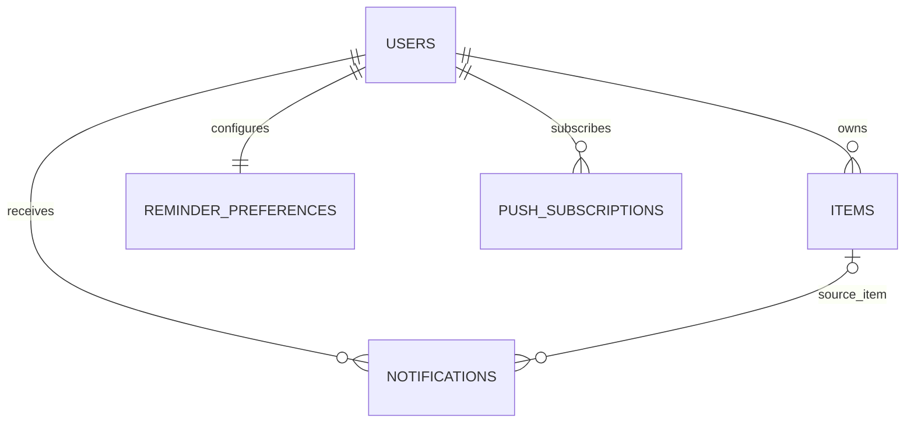

# ExpiryMate 数据库设计说明

> 数据库：MySQL 8.0.16+（InnoDB，utf8mb4）  
> 版本：1.1  
> 适用范围：ExpiryMate 前后端分离 Web 第一阶段

## 文件用途与初始化

`ExpiryMate-database.sql` 是 MySQL 初始化脚本，会创建 `expirymate` 数据库（若不存在）并创建所需表；不会删除已有表或数据。建议使用 MySQL 8.0.16 或更新版本，以确保 `CHECK` 约束能够生效。

```powershell
mysql -u root -p < "E:\code\product\ExpiryMate\ExpiryMate-doc\ExpiryMate-database.sql"
```

正式后端应将结构纳入 Flyway 迁移，例如 `backend/src/main/resources/db/migration/V1__initial_schema.sql`。后续变更通过新的迁移版本管理。

## 实体关系



- 一个用户拥有多件物品；用户删除时，其物品、提醒偏好、通知和推送订阅级联删除。
- 每个用户对应一条提醒偏好。注册流程应在同一事务中创建默认偏好（提前 7、3、1、0 天，站内通知）。
- `remind_before_days` 和 `channels` 使用 JSON 数组存储；后端必须校验数组长度、允许值、范围，并对提醒天数去重排序。
- 通知保存物品名称和到期日快照；物品软删除后通知仍可展示。物理删除物品时，外键将通知的 `item_id` 设为空。
- 一个用户可登记多个浏览器推送订阅。撤销订阅后，生成列 `active_endpoint_hash` 变成 NULL；唯一索引允许历史撤销订阅保留，同时防止有效端点重复。

## 表说明

| 表 | 用途 | 关键规则 |
|---|---|---|
| `users` | 账号、密码哈希和用户时区 | `email_lower` 生成列实现忽略大小写唯一；密码只存哈希 |
| `items` | 物品及日期信息 | `expires_on` 是状态计算权威日期；数量大于 0；支持软删除 |
| `reminder_preferences` | 提醒开关、提前天数、时间和渠道 | JSON 数组由后端校验；站内提醒为基础渠道 |
| `notifications` | 站内通知与推送任务记录 | 用户、幂等键和渠道唯一，避免重复通知 |
| `push_subscriptions` | Web Push 浏览器订阅 | 端点和密钥以应用层密文保存；加密密钥由数据库外部管理 |

## 核心字段与接口映射

数据库字段使用 `snake_case`；REST JSON 使用 `camelCase`。后端 DTO 负责映射，例如 `expires_on` ↔ `expiresOn`、`purchased_on` ↔ `purchasedOn`。

保质期单位使用 `days`、`months`、`years`。前端显示“天、月、年”，提交 API 时发送英文代码。物品状态值：

- `active`：仍在管理中。
- `used_up`：已用完。
- `discarded`：已丢弃。
- `processed`：已处理（前端演示状态 `done` 由 API 适配层映射）。

物品日期使用 MySQL `DATE`。`TIMESTAMP` 会按数据库会话时区转换，`DATETIME` 不携带时区；建议后端连接会话统一设置为 UTC，提醒时间按用户保存的 IANA 时区解释，并以用户本地自然日计算。

UUID 以 `CHAR(36)` 保存，便于 Java 和前端直接处理。数据量增大后，可评估使用 `BINARY(16)` 降低索引体积，但需统一约定 UUID 编解码方式。

## 索引设计

- `items(user_id, status, deleted_at, expires_on, id)` 支持活动物品和临期列表查询。
- 分类、位置及用户物品名称索引支持筛选和查找；列表查询仍需按用户授权范围分页。
- `notifications` 上的用户收件箱、未读和推送队列索引支持通知中心及待发送任务扫描。
- MySQL 不支持 PostgreSQL 风格的部分索引；脚本将筛选列纳入复合索引，并用生成列实现有效推送端点的唯一性。

## 后端实现约束

1. 每次查询和写操作都必须按认证用户的 `user_id` 限定范围。
2. 删除物品时执行软删除（设置 `deleted_at`），一般列表、统计及提醒扫描都排除已删除记录。
3. 注册用户时，在同一个数据库事务内创建默认提醒偏好。
4. 提醒使用稳定 `dedupe_key`（物品 ID、规则和用户本地触发日期）；唯一约束负责最终防重。
5. Web Push 的 endpoint、p256dh 和 auth 密钥由后端加密后写入 `*_ciphertext` 列；密钥或 KMS 凭据不存入数据库。
6. 后端数据库连接会话设为 UTC；用户时区只用于解释提醒时间及计算本地触发日期。
7. 账户删除会级联删除物品、通知和订阅，应在账户删除流程中明确告知用户。

## 与前端原型对接

前端本地模式使用 camelCase 字段并保存在浏览器 `localStorage`。设置 `VITE_API_BASE_URL` 后调用 `/api/v1/items`。后端 DTO 接收并返回 camelCase JSON；前端提交保质期单位时映射为 `days`、`months`、`years`，并将演示状态 `done` 映射为 `processed`。浏览器不得直接连接数据库。

## 后续迁移

此 SQL 是初始结构。后端启用后将其纳入 Flyway 的 `V1__initial_schema.sql`，结构变更通过新的版本迁移完成。不要在生产库手工改表，也不要将数据库密码提交到代码仓库。
